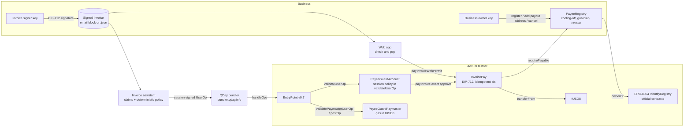
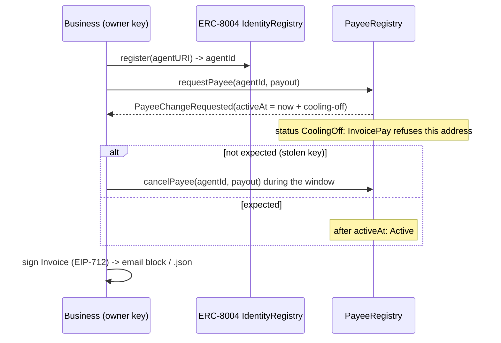
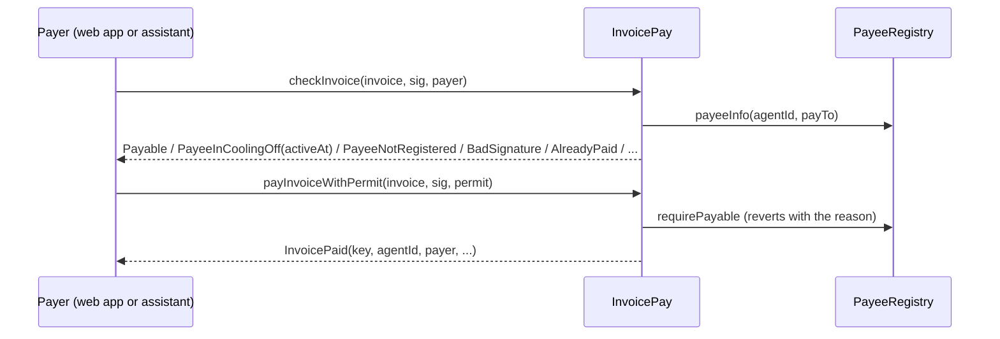
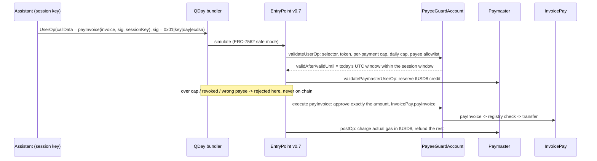

# PayeeGuard

**Confirmation of payee for stablecoin invoices, with AI agents that pay through scoped ERC-4337 session keys.**
Built for the Aevum Builder Challenge #1 on the QDay Aevum testnet (chain 44005), tracks: Confirmation of Payee,
Invoice Payments, Native AI Assistants.

**Live app: https://payeeguard-theta.vercel.app** (check & pay, business console, agent account; reads Aevum
testnet directly, wallet needed only to sign). Also packaged as a Docker image: see the `Dockerfile`.
**Demo video: https://payeeguard-theta.vercel.app/demo.html** (4 min, every transaction real; recorded and narrated
by `tools/demo-video`, which drives the live app in headless Chrome with a test wallet; synthetic voice).

> Every component below is deployed and was exercised end to end on Aevum testnet: transactions are linked in
> [Live on Aevum](#live-on-aevum-testnet). Testnet only; no real funds.

## The problem

Invoice redirection is the classic business payment fraud: a supplier's mailbox or invoicing tool is compromised and
the customer receives a perfectly normal invoice that says *"our bank details have changed"*. Banks answer this with
Confirmation / Verification of Payee. Stablecoin payments have nothing comparable, settle instantly and cannot be
reversed. AI assistants that read email and pay invoices make it worse: they can be talked into paying anyone.

## What PayeeGuard does

**1. The payee change is the attack, so the change is what we guard.**
A business binds payout addresses to its ERC-8004 identity in `PayeeRegistry`. A new or changed address is **not
payable for a cooling-off period** (48 h by default, 2 min on the demo deployment) and every change emits an event.
The business can cancel inside the window; revocation is immediate. `InvoicePay` pays only EIP-712 invoices signed
by the business **to an address that is active and past its cooling-off**. A stolen invoicing key can sign a valid
"new bank details" invoice, but it cannot get it paid faster than the business can notice and cancel.

**2. Real account abstraction for the agent, not a vault.**
The payer uses our ERC-4337 v0.7 smart account. An AI assistant gets a **session key whose policy is enforced in
`validateUserOp`**: only `payInvoice`, one token, per-payment cap, daily cap, validity window and an allowlist of
ERC-8004 payees. An over-cap, wrong-payee or revoked request is rejected by the bundler before anything executes.
Operations go through **QDay's own bundler**, and gas is paid **in tUSD8** through our paymaster: the payer account
holds no tQDAY at all.

**3. The assistant never decides who gets paid.** It reads the email, but the payee, amount and token come only
from the signed invoice and the on-chain registry. Text in the email that tries to redirect the payment is reported
as a prompt-injection attempt and ignored. Above its caps it asks the human.

## Architecture



| Component | Path | What it is |
|---|---|---|
| PayeeRegistry | `contracts/src/PayeeRegistry.sol` | Payout addresses per ERC-8004 identity: request -> (guardian approval) -> cooling-off -> active; cancel, revoke, policy, invoice signer |
| InvoicePay | `contracts/src/InvoicePay.sol` | Verifies the EIP-712 invoice (ECDSA or ERC-1271), checks the registry, pays once per invoice id, emits `InvoicePaid`; `checkInvoice` is a non-reverting verdict for wallets and agents |
| PayeeGuardAccount + factory | `contracts/src/PayeeGuardAccount*.sol` | ERC-4337 v0.7 account: owner key with full control, session keys limited in `validateUserOp` |
| PayeeGuardPaymaster | `contracts/src/PayeeGuardPaymaster.sol` | Charges gas in tUSD8 from prepaid credit; pays the EntryPoint in tQDAY |
| ERC-8004 IdentityRegistry | `contracts/lib/erc-8004-contracts` | Official, unmodified contracts, deployed by us (the canonical 0x8004... deployment is not on Aevum) |
| SDK | `sdk/` (`@payeeguard/sdk`) | viem-based: account adapter, invoices, payee checks, bundler client, error explanations |
| Web app | `web/` | Check & pay, business console, agent account view |
| Assistant | `assistant/` | Email -> signed invoice -> on-chain check -> decision -> session-key payment, JSONL audit log |
| Tools | `tools/` | Bundler smoke test, our Alto runner, a cdk-erigon RPC shim |

## Core workflows

### Business: add a payout address (cooling-off) and sign invoices



### Payer: check and pay



### Agent: pay through a session key, gas in tUSD8



## Live on Aevum testnet

Explorer: https://explorer-test.qday.info · RPC `https://rpc-test.qday.info` · chain 44005 ·
addresses also in [`contracts/deployments/44005.json`](contracts/deployments/44005.json).

| Contract | Address |
|---|---|
| ERC-8004 IdentityRegistry (proxy) | [`0xAE63Cd12d1a7c3F8E1B494d79fe6373829b91049`](https://explorer-test.qday.info/address/0xAE63Cd12d1a7c3F8E1B494d79fe6373829b91049) |
| PayeeRegistry (demo cooling-off 120 s) | [`0x6157173183409db90dc31cC26A9301D87433F482`](https://explorer-test.qday.info/address/0x6157173183409db90dc31cC26A9301D87433F482) |
| InvoicePay | [`0x63DdA7ff73DFb7504eA1cC84aeCa26E9B7a682b0`](https://explorer-test.qday.info/address/0x63DdA7ff73DFb7504eA1cC84aeCa26E9B7a682b0) |
| PayeeGuardAccountFactory | [`0x9f91bAfDDbA52a55D38a5FEa123CA762742FC4BB`](https://explorer-test.qday.info/address/0x9f91bAfDDbA52a55D38a5FEa123CA762742FC4BB) |
| PayeeGuardPaymaster (staked 0.1 tQDAY) | [`0x8Df80bC67E09686C1250a408e8042c0B7A415a0f`](https://explorer-test.qday.info/address/0x8Df80bC67E09686C1250a408e8042c0B7A415a0f) |
| EntryPoint v0.7 (QDay) | `0x0000000071727De22E5E9d8BAf0edAc6f37da032` |
| tUSD8 (QDay) | `0x456569838f1d43009A91ebA4263147Afd7233483` |

Evidence (16 Nov 2026):

| What happened | Transaction |
|---|---|
| Forela Ltd (agent #0) invoice paid with tUSD8 | [`0xe8186fed…3253`](https://explorer-test.qday.info/tx/0xe8186fed9654da5a7d2c82f75c2573b8606f34634340e3c671316fe40ff53253) |
| Stolen-key "new bank details" address requested, refused by `checkInvoice` (PayeeInCoolingOff), then cancelled | [`0x98146191…35bd`](https://explorer-test.qday.info/tx/0x98146191ab1b1c01630eda1a74e5b9946e619ae43774e7b6af50fcad7b9335bd), [`0x505e3a87…6a1c`](https://explorer-test.qday.info/tx/0x505e3a8769a0f504bbf533c015d8bee8b3cc9c9f90d525d1462ff4bbca846a1c) |
| Smart account deployed through initCode + session granted, gas in tUSD8 | [`0x7d5afd13…ee00`](https://explorer-test.qday.info/tx/0x7d5afd1351ab79d5f76c76256a3adf328d911907ea24c4517b89107c2cccee00) |
| Agent pays through its session key via QDay's bundler | [`0xcd00374a…2bdd`](https://explorer-test.qday.info/tx/0xcd00374abc28579189279f1c8abf7885245ac81e08b0080acf005ada9c422bdd) |
| Owner revokes the session (next request fails `SessionNotActive`) | [`0x57e90f23…ad16`](https://explorer-test.qday.info/tx/0x57e90f23047ea40519bc2ff7deb00a638e1095cb696120f80912c9fcc88bad16) |
| Assistant pays a real invoice; pays an injected email to the signed payee, not the injected one | [`0x91166207…e1ff`](https://explorer-test.qday.info/tx/0x911662072609e4f560ca907dc0a998f2dff3d3157fa73cb74284bb89a650e1ff), [`0xfaf9457b…2307`](https://explorer-test.qday.info/tx/0xfaf9457b2c88b4d611199c23f5f6320b9911547d3a290434da59e4db8dea2307) |

The demo video run (16 Nov 2026, 21:35-21:48 Baku): the live web app driven with a test wallet, then the assistant.

| What happened | Transaction |
|---|---|
| Business adds a "new bank details" payout address in the web app (cooling-off starts) | [`0x07d0a0b4…0f92`](https://explorer-test.qday.info/tx/0x07d0a0b453cc7e152f2670b866075bc97ce70fac9c7c1974b1fdf437cab20f92) |
| Business cancels it inside the window | [`0x7eb29566…0408`](https://explorer-test.qday.info/tx/0x7eb29566fc332d1a222ee562e8aaebdf4d3ef752c0fb17b9dacbfc080ef90408) |
| Payer pays a genuine invoice from the web app (EIP-2612 permit + one transaction) | [`0x641e8c22…f44b`](https://explorer-test.qday.info/tx/0x641e8c22e6c8e44955d63625b779c367ea05fb93b4830b5080f37a0320acf44b) |
| Owner grants the assistant a session key (UserOperation, gas in tUSD8) | [`0x801cd6d9…b4fb`](https://explorer-test.qday.info/tx/0x801cd6d9d7d278ab1bbcb96b7971832b5140cd5a4cdcd3fef9277cf1ad69b4fb) |
| Assistant pays an invoice; pays a prompt-injection email to the signed payee only | [`0x776ff17e…4631`](https://explorer-test.qday.info/tx/0x776ff17e5258a934e613e095dc5b9b07af7d75466a1d9f251a95312239ae4631), [`0xbf7e3849…9f14`](https://explorer-test.qday.info/tx/0xbf7e3849377aa24e801085762799cb9d853f98f1b3e7c96fff5760e545f79f14) |
| Owner revokes the session from the web app (gasless UserOperation through QDay's bundler) | [`0x02a8b08a…198c`](https://explorer-test.qday.info/tx/0x02a8b08aeb2fa161fb92a36bcdd5edb4cc28a72ca72a30aafa2884f8aea2198c) |

Rejected operations (over a cap, revoked key, policy-ignoring assistant) never reach the chain; they show up in the
bundler's answer, decoded by the SDK, and in the assistant's log.

## QDay platform integration

| Platform piece | How PayeeGuard uses it |
|---|---|
| ERC-4337 EntryPoint v0.7 (live on Aevum) | Our account, factory and paymaster run on it |
| QDay bundler `https://bundler.qday.info` (rundler, ERC-7562 safe mode) | Default bundler of the SDK, web app and assistant. Not yet in the docs; found in qday-io/qday-bundler |
| tUSD8 (EIP-2612, 6 decimals) | Invoice currency; one-signature payments via permit; gas currency through the paymaster |
| ERC-8004 | Business identities (official IdentityRegistry, unmodified); registration files that name their own agentId |
| Aevum (cdk-erigon zkEVM, Shanghai) | All contracts compiled for `evm_version = "shanghai"`; checked by `contracts/script/check_opcodes.py` |

**Developer notes from building on Aevum** (also useful as bug reports for QDay):

- Aevum is Shanghai-level: MCOPY, TSTORE/TLOAD and BLOBHASH are invalid. OpenZeppelin 5.4's `SignatureChecker`
  imports `Bytes.sol`, which uses MCOPY, so it does not compile for Shanghai; InvoicePay does ECDSA + ERC-1271 itself.
- QDay's bundler runs in **safe mode**: validation may not read TIMESTAMP, so session expiry and the daily window are
  returned as `validAfter`/`validUntil` (the session signs a UTC day index); validation touches only the account's
  own storage; the paymaster is staked (0.1 tQDAY, 1 day) because it keeps credit in its own storage.
- `eth_getLogs` is capped at 1000 blocks; the SDK pages every scan.
- cdk-erigon rejects 32-byte padded state-override values in `eth_call` ("hex number with leading zero digits"),
  which breaks Alto's simulation. `tools/rpc-shim` rewrites them; with it our own Alto bundler works as a fallback.
- rundler answers "data did not match any variant of untagged enum RpcUserOperationOptionalGas" for any malformed
  field, e.g. an odd-length stub signature. The SDK also pins the nonce key to 0 (viem defaults to a time-based key).
- The testnet explorer's verifier lists no Solidity compiler versions and has verified 0 of 481 contracts
  (`/api/v2/smart-contracts/counters`, 16 Nov), so explorer verification is pending. Until it works,
  `contracts/script/match_onchain.py` shows every deployed contract's runtime bytecode equals this source.

## Security model

| Threat | Control |
|---|---|
| Stolen invoicing key sends "new bank details" | New addresses are not payable during the cooling-off; every change emits an event; the business cancels; the invoice signer key cannot add addresses at all |
| Stolen owner key | Same cooling-off; optional guardian key must approve new addresses; weakening the policy (shorter cooling-off, removing the guardian) waits for the current cooling-off and can be cancelled |
| Identity sold or transferred | Payout addresses, signer and policy are scoped to (agentId, current owner): a new owner starts empty |
| Forged or altered invoice | EIP-712 signature by the identity owner or its signer, ECDSA or ERC-1271 |
| Double payment / retries | One receipt per (agentId, invoiceId); `InvoiceAlreadyPaid` |
| Prompt injection into the assistant | Payee only from the signed invoice; injected instructions logged and ignored; payment decision is deterministic |
| Compromised or buggy agent | Session policy in `validateUserOp`: only `payInvoice`, token, per-payment and daily caps, payee allowlist, expiry; exact one-shot approve, no standing allowance; instant revoke |
| Paymaster drain | Worst-case cost reserved in validation, refunded in postOp; fees separate from users' credit |

Assumptions and limits: the testnet paymaster uses a fixed tQDAY/tUSD8 rate set by its owner (no oracle on testnet);
daily spend is counted per session key and UTC day and is consumed at validation even if execution then fails;
the cooling-off protects only payers that pay through InvoicePay (or check it); email/domain verification of the
business beyond the ERC-8004 registration file is out of scope.

## Run it yourself

Prerequisites: Foundry, Node 22, pnpm, Python 3 (`py` on Windows). Testnet keys live in a git-ignored `.env` at the
repo root:

| Variable | Used by | Purpose |
|---|---|---|
| `DEPLOYER_KEY` | forge scripts, demos | deploys and funds test wallets |
| `BUSINESS_KEY` | DemoFlow, make-invoices | Forela Ltd identity owner and invoice signer |
| `PAYER_OWNER_KEY` | session demo, assistant `grant` | owner of the payer smart account |
| `ATTACKER_ADDR` | demos | the "new bank details" address |
| `BUNDLER_KEY` | tools/alto | our own Alto executor (optional) |
| `ASSISTANT_LLM=claude` | assistant | optional: Claude extracts the email's claims (needs Anthropic credentials) |

```bash
git clone --recurse-submodules https://github.com/emilhuseyn/aevum-qday && cd aevum-qday
cd contracts && forge test && py script/check_opcodes.py && py script/match_onchain.py && cd ..
cd sdk && pnpm install && npx vitest run && cd ..
cd web && pnpm install && pnpm dev          # http://localhost:5173
cd assistant && pnpm install && pnpm grant && pnpm pay examples/legit.txt
```

Deploy your own copy (Aevum testnet):

```bash
cd contracts
( set -a; . ../.env; set +a; forge script script/Deploy.s.sol --rpc-url aevum --broadcast --slow --with-gas-price 2000000000 --priority-gas-price 1000000000 )
# then DeployAccountFactory.s.sol and DeployPaymaster.s.sol the same way; addresses land in deployments/44005.json
cd ../sdk && pnpm gen:abis
```

Demos: `contracts/script/DemoFlow.s.sol` (Lead 1 with forge), `sdk/examples/session-demo.ts` (Lead 2),
`assistant/` with the five emails in `assistant/examples/` (regenerate with `sdk/examples/make-invoices.ts`). The
video script is in [`docs/DEMO.md`](docs/DEMO.md).

## Tests

| Suite | Count | Covers |
|---|---|---|
| `contracts/test/PayeeRegistry.t.sol` | 35 | cooling-off, cancel, revoke, guardian, policy strengthen/weaken, identity transfer, fuzz |
| `contracts/test/InvoicePay.t.sol` | 22 | the "new bank details" attack, signatures (ECDSA, ERC-1271, hot key), expiry, idempotency, permit, calldata layout, fuzz |
| `contracts/test/PayeeGuardAccount.t.sol` | 24 | session policy against a real EntryPoint v0.7: caps, daily window, allowlist, AA22/AA23/AA24 paths, revoke, initCode |
| `contracts/test/PayeeGuardPaymaster.t.sol` | 7 | gas in tUSD8, reservation/refund, insufficient credit, no-native-token deployment |
| `sdk/test` | 15 | signatures, invoices, invoice files, error decoding, on-chain parity (`AEVUM_INTEGRATION=1`) |
| `assistant/test` | 11 | claims extraction, injection, every decision path |

End to end, `tools/demo-video/record.ts` exercises every wallet write path of the live web app (add and cancel a
payout address, permit payment, owner revoke through the bundler) plus the assistant, against Aevum testnet. It
signs through a test-wallet bridge (`tools/demo-video/wallet.ts`: an EIP-1193 provider whose keys stay in the Node
process). `py tools/demo-video/build_video.py` then narrates the footage into the demo video.

## Business model and roadmap

Payers pay per check or per protected payment (a few cents in stablecoin), businesses get the registry for free
because every verified business makes the network more useful. Distribution: invoicing tools and accounting
platforms embed the SDK check before "pay", and agent frameworks use the session account for bill-pay agents.

Next: mainnet deployment with an oracle-priced paymaster; the session policy as an ERC-7579 validator for Kernel
(already deployed on Aevum); domain verification via `/.well-known/agent-registration.json`; notifications on
`PayeeChangeRequested` (email/webhook) so a business hears about a change within minutes; a subgraph for history;
post-quantum signer support once QDay ships its precompiles.

## How this was built

All code was written in the build window: the first code commit is `c4991d8` on 16 Nov 2026 at 11:47 (UTC+4).
Earlier commits contain only planning notes.

License: MIT (see [LICENSE](LICENSE)). The ERC-8004 contracts, OpenZeppelin and eth-infinitism account-abstraction
are used as git submodules under their own licenses.
